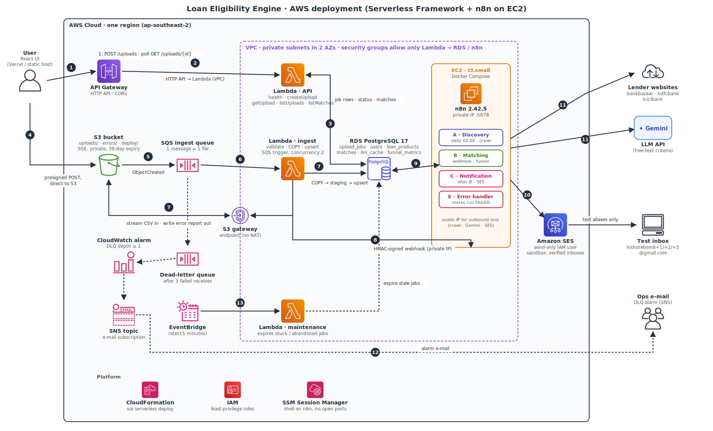
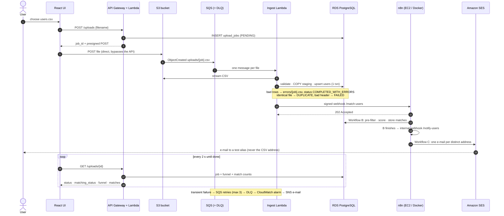
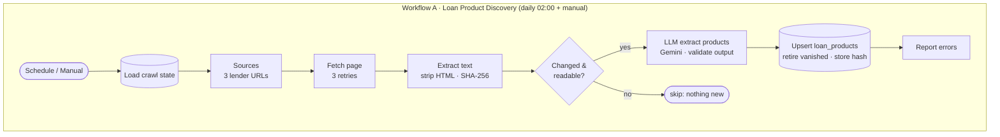
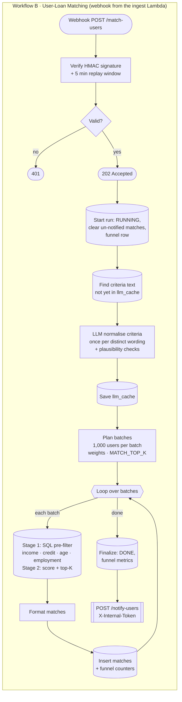
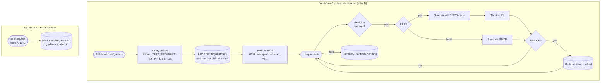

# Loan Eligibility Engine

Upload a CSV of users → they are loaded into **Amazon RDS for PostgreSQL** by an event-driven pipeline → a self-hosted **n8n** matches them against loan products it discovered by crawling lender websites → matched users are e-mailed through **Amazon SES** (to test-inbox aliases only).

* **AWS (Serverless Framework):** S3 → SQS (+DLQ) → Lambda → RDS, HTTP API, SES, CloudWatch/SNS alarm, and the **EC2 host that runs n8n in Docker** — all created by one `serverless deploy`.
* **n8n (Docker Compose):** four workflows — **A** product discovery (crawler), **B** user-loan matching (the optimisation funnel), **C** notification, **E** error handler.
* **UI:** a small React app: drop a CSV, watch the pipeline run, browse the matches.

| | |
|---|---|
| Backend | Python 3.12 Lambdas, `psycopg`, no web framework |
| Database | RDS PostgreSQL 17 (migrations in `backend/migrations`) |
| Automation | n8n 2.42.5 (self-hosted, Docker) |
| LLM | Gemini (`gemini-3.5-flash-lite`) — used sparingly, see [the Treasure Hunt](#the-optimization-treasure-hunt-workflow-b) |
| Email | Amazon SES via the n8n **AWS SES** node |

**Contents:** [Requirements map](#requirements-map) · [Architecture](#1-system-architecture-on-aws) · [End-to-end workflow](#2-end-to-end-workflow-user--system) · [n8n workflows](#3-n8n-workflows) · [Setup & deployment](#4-setup--deployment-on-aws) · [Design decisions](#5-design-decisions) · [Tests & layout](#6-tests-and-repository-layout) · [Limitations](#7-limitations)

---

## Requirements map

| Requirement | Where it is implemented |
|---|---|
| Scalable, event-driven CSV ingestion (not a plain API Gateway upload) | Browser → **presigned S3 POST** → S3 `ObjectCreated` → **SQS** (+DLQ) → ingest **Lambda** (`backend/app/ingestion.py`) |
| Persist users in a dedicated RDS PostgreSQL table | `users` table, loaded with `COPY` + upsert in one transaction (`backend/migrations/001_init.sql`) |
| Self-hosted n8n in Docker | `docker-compose.aws.yml` on the EC2 host created by the stack (`docker-compose.yml` is the same setup for a laptop) |
| **Workflow A** — daily crawl of 2–3 sites → `loan_products` | `n8n/workflows/wfA_discovery.json` (bankbazaar, hdfcbank, icicibank) |
| **Workflow B** — webhook-triggered matching → `matches`; multi-stage optimisation | `n8n/workflows/wfB_matching.json` — SQL pre-filter → scoring → LLM only for free-text criteria, cached |
| **Workflow C** — after B, personalised e-mail via the **AWS SES node** to test aliases | `n8n/workflows/wfC_notify.json` |
| Minimal UI for the CSV upload | `frontend/` (React + Vite) |
| `serverless.yml` / `docker-compose.yml` / workflow JSON | `backend/serverless.yml`, `docker-compose.yml` + `docker-compose.aws.yml`, `n8n/workflows/*.json` |
| README: diagram, setup & credentials, design decisions | this file |

---

## 1. System architecture on AWS



<sub>Vector version: [docs/aws-architecture.svg](docs/aws-architecture.svg). Icons are the official AWS service icons.</sub>

| # | What happens | Why it is built this way |
|---|---|---|
| **1** | The UI calls `POST /uploads` on the **HTTP API** (API Gateway → Lambda). The Lambda inserts an `upload_jobs` row (`PENDING`) and returns a **presigned S3 POST**. | The API only ever handles a few hundred bytes, so API Gateway's 10 MB / 29 s limits never apply. |
| **2** | API Gateway invokes the API Lambda (inside the VPC, so it can reach RDS). | One Lambda handler per route (`createUpload`, `getUpload`, `listUploads`, `listMatches`, `reprocessUpload`, `health`). |
| **3** | API Lambdas read/write job rows and read matches in **RDS**. | The UI polls `GET /uploads/{id}` for progress. |
| **4** | The browser uploads the file **directly to S3**. The signed policy enforces `Content-Type: text/csv` and 1 B – 50 MB. | The file never passes through Lambda; S3 absorbs any size. |
| **5** | S3 emits `ObjectCreated` (prefix `uploads/`) to **SQS**. | One message = one file (never one per row). SQS buffers bursts and retries. |
| **6** | SQS triggers the **ingest Lambda** (batch size 1, max concurrency 2, partial-batch failure reporting). | The concurrency cap protects RDS connections. |
| **7** | The Lambda streams the CSV from S3 (through the free **S3 gateway endpoint** — there is no NAT), validates every row, `COPY`s valid rows into a temp staging table, **upserts** into `users` in a single transaction, and writes a per-row error report back to S3. | Atomic and idempotent: a crash before commit leaves nothing behind, so SQS redelivery simply redoes it. |
| **8** | After the commit the Lambda calls **n8n Workflow B** with an **HMAC-SHA256-signed webhook** over the VPC's private network (port 5678, reachable only from the Lambda security group). | n8n is never exposed to the internet; the signature + 5-minute window blocks forged or replayed calls. |
| **9** | n8n reads users/products from RDS and writes `matches`, `loan_products`, `llm_cache`, `funnel_metrics`. | All state lives in Postgres. |
| **10** | Workflow C sends mail with the **AWS SES** node (credentials of a send-only IAM user) to **test aliases** of your Gmail. | Real CSV addresses are never mailed unless `NOTIFY_LIVE=true`. |
| **11** | Workflow A crawls the lender sites and calls the Gemini API; Workflow B calls Gemini once per distinct free-text criteria. | The EC2 host has a public IP for **outbound** traffic only. |
| **12** | After 3 failed receives a message lands in the **DLQ**; a **CloudWatch alarm** notifies an **SNS** e-mail topic. | Nothing is lost silently. |
| **13** | An **EventBridge** schedule runs the **maintenance Lambda** every 15 min: it fails jobs whose file never arrived (`PENDING` > 60 min) or whose every attempt timed out (`PROCESSING` > 100 min). | A Lambda timeout cannot be caught in code, so a sweeper closes those jobs. |

Platform pieces: **CloudFormation** (via the Serverless Framework) creates everything; **IAM** roles are least-privilege (the Lambdas may only `PutObject`/`GetObject` on the bucket; the n8n SES user may only send mail); **SSM Session Manager** gives shell and editor access to the n8n host with no open ports.

---

## 2. End-to-end workflow (user + system)



Job states the UI shows: `PENDING → PROCESSING → COMPLETED | COMPLETED_WITH_ERRORS | FAILED | DUPLICATE`, then matching `NOT_STARTED → RUNNING → DONE | FAILED`.

---

## 3. n8n workflows

The four workflows are generated from readable sources (`n8n/code/*.js` for the Code nodes, SQL and wiring in `n8n/build_workflows.py`) into `n8n/workflows/*.json`. A test fails if the committed JSON drifts from its sources.







| Workflow | Trigger | Key behaviour |
|---|---|---|
| **A** Discovery | Schedule (daily 02:00) or manual | Skips a page whose content hash is unchanged; the LLM extracts products as JSON, the output is validated before any write; products that vanished from a page are deactivated only if the new crawl found something; a failed extraction is recorded in `crawl_state.last_status` and the execution turns red. |
| **B** Matching | HMAC-signed webhook from the ingest Lambda | Answers `202` immediately and works in batches of 1,000 users; every write is idempotent; a re-run replaces matches that were not e-mailed yet. |
| **C** Notification | Internal webhook called by B when it finishes | One e-mail per distinct address (users sharing an e-mail are merged, best score per product); failures leave matches un-notified so the next run retries. |
| **E** Error | n8n error trigger | Marks the matching run `FAILED` using the stored n8n execution id so the UI shows it. |

---

## 4. Setup & deployment on AWS

Everything below runs from a laptop with the AWS CLI. **Cost:** RDS and EC2 bill hourly while they exist (there is no NAT gateway); do the [teardown](#48-teardown) afterwards.

### 4.0 Prerequisites
* AWS CLI v2 configured with credentials that can create CloudFormation, S3, SQS, Lambda, RDS, EC2, SES and IAM resources (`aws configure`; check with `aws sts get-caller-identity`). **These are your deployment credentials; n8n gets its own, below.**
* Node 20+, Docker running (the Serverless plugin builds Linux wheels in a container), and a Gmail address you control (written `abcd@gmail.com` below).
* Pick **one region** for everything (SES identities are per region):
  ```bash
  export AWS_REGION=ap-southeast-2 AWS_DEFAULT_REGION=ap-southeast-2 STAGE=dev
  ```

### 4.1 Configure
```bash
eval "$(bash infra/aws_network_env.sh)"     # prints VPC_ID, SUBNET_A_ID, SUBNET_B_ID, ROUTE_TABLE_ID of the default VPC
cd backend
cp deploy.env.example deploy.env            # holds secrets, git-ignored
```
Fill `deploy.env` (every variable is explained inside the file):

| Variable | Meaning |
|---|---|
| `VPC_ID`, `SUBNET_A_ID`, `SUBNET_B_ID`, `ROUTE_TABLE_ID` | An existing VPC with two subnets in **different AZs** and their route table (gets the free S3 gateway endpoint). |
| `DB_PASSWORD`, `WEBHOOK_SECRET`, `N8N_ENCRYPTION_KEY` | Secrets: `openssl rand -hex 16` / `-hex 32`. `WEBHOOK_SECRET` is shared by the Lambdas and n8n. |
| `SES_SENDER_EMAIL`, `TEST_RECIPIENT`, `SES_RECIPIENT_1..3` | `abcd@gmail.com`, `abcd@gmail.com`, `abcd+1@gmail.com`, `abcd+2@gmail.com`, `abcd+3@gmail.com`. The stack creates these SES identities. |
| `GEMINI_API_KEY` | From <https://aistudio.google.com/apikey>; needed by Workflow A and for free-text criteria. |
| optional | `API_KEY` (shared `x-api-key` for the HTTP API), `CORS_ORIGIN` (UI origin), `ALERT_EMAIL` (DLQ alarm), `NOTIFY_MAX_EMAILS`, `MATCH_TOP_K`, instance sizes. |

### 4.2 Deploy the AWS stack
```bash
npm install --no-save serverless@3 serverless-python-requirements
set -a; . ./deploy.env; set +a
npx serverless deploy --stage $STAGE        # 10–15 min, RDS dominates
npx serverless invoke -f migrate --stage $STAGE   # {"applied": ["001_init.sql"]}
npx serverless invoke -f seed --stage $STAGE      # a few illustrative products so matching works before any crawl
aws cloudformation describe-stacks --stack-name loan-eligibility-engine-$STAGE \
  --query 'Stacks[0].Outputs[].[OutputKey,OutputValue]' --output text      # HttpApiUrl, N8nInstanceId, …
curl <HttpApiUrl>/health                    # {"status": "ok"}  → API Lambda reaches RDS
```
(Later deploys: `STAGE=$STAGE npm run deploy` deploys and migrates in one command.)

What the stack created: the S3 bucket and notification, SQS queue + DLQ + alarm + SNS topic, all Lambdas and the HTTP API, RDS PostgreSQL, the VPC endpoint and security groups, the SES identities, the send-only IAM user for n8n, and the **EC2 instance that will run n8n**.

### 4.3 Verify the e-mail identities
SES is in sandbox: it can only send to verified addresses. CloudFormation made SES mail a verification link to the sender and each recipient; open the Gmail inbox and click every link, then check:
```bash
aws sesv2 list-email-identities --query 'EmailIdentities[].[IdentityName,VerificationStatus]' --output text   # all SUCCESS
```

### 4.4 Launch n8n and configure its credentials
The EC2 host installs Docker on first boot and waits for the workflow bundle. Upload it (from the repo root):
```bash
cd ..
bash infra/upload_n8n_bundle.sh $STAGE
```
Within about a minute the host starts n8n with `docker compose -f docker-compose.aws.yml --env-file .env.aws up -d`. **You do not click credentials together by hand:** a one-shot `n8n-init` container (`n8n/init.sh`) creates them from environment values, imports the four workflow JSON files and publishes A, B and C. The values are written by the stack into `/opt/n8n/.env.aws` at boot, so nothing has to be copied by hand.

| n8n credential | Used by | Values | Where they come from |
|---|---|---|---|
| **Loans Postgres** | every Postgres node | `APP_DB_HOST`, `APP_DB_PASSWORD` (+ port 5432, db `loans`, user `loans`, SSL `require`) | the RDS endpoint and the `DB_PASSWORD` you set |
| **AWS SES** | *Send via AWS SES* in Workflow C | `AWS_SES_ACCESS_KEY_ID`, `AWS_SES_SECRET_ACCESS_KEY`, `AWS_SES_REGION` | an IAM user the stack creates that may **only** `ses:SendEmail` / `SendRawEmail` |
| **Local Mailpit SMTP** | SMTP branch (laptop use only) | unused on AWS | placeholder |

Other settings the workflows read with `$env` (all in `.env.aws`): `WEBHOOK_SECRET`, `GEMINI_API_KEY` / `GEMINI_MODEL`, `TEST_RECIPIENT`, `NOTIFY_MAX_EMAILS`, `NOTIFY_LIVE=false`, `SES_FROM`, `MATCH_TOP_K`. To change one: edit `/opt/n8n/.env.aws` on the host and run `sudo docker compose -f docker-compose.aws.yml --env-file .env.aws up -d --force-recreate`.

Check the host and, optionally, open the n8n editor (no inbound ports are open; SSM tunnels in):
```bash
aws ssm start-session --target <N8nInstanceId>      # then: sudo docker ps ; curl -s localhost:5678/healthz
aws ssm start-session --target <N8nInstanceId> --document-name AWS-StartPortForwardingSession \
  --parameters '{"portNumber":["5678"],"localPortNumber":["5678"]}'      # editor at http://localhost:5678
```
In the editor, run **A - Loan Product Discovery** once (*Execute workflow*) to crawl real products.

### 4.5 The UI
```bash
cd frontend
echo "VITE_API_URL=<HttpApiUrl>" > .env        # add VITE_API_KEY=… only if you set API_KEY
npm install && npm run build                    # deploy frontend/dist on Vercel (root directory: frontend) or any static host
```
Set `CORS_ORIGIN` in `deploy.env` to the UI's origin and redeploy if it is not `*`.

### 4.6 Run it
1. Open the UI and upload `users.csv` (10,000 users). The browser gets a presigned URL and sends the file **straight to S3**.
2. Watch the pipeline: `PENDING → PROCESSING → COMPLETED` within seconds, then matching `RUNNING → DONE` in about 30–60 s. The matches table and the **optimisation funnel** (pairs at each stage, LLM calls) appear.
3. Open the Gmail inbox: up to `NOTIFY_MAX_EMAILS` e-mails addressed to `abcd+1…`, none to the CSV addresses. (Gmail may file mail from a `@gmail.com` sender sent through SES under **Spam**, because it cannot pass DMARC alignment — mark it "Not spam", or verify a domain you own in SES and use it as sender.)
4. Upload the same file again → `DUPLICATE`; click **Process anyway** in the UI to run the whole pipeline again. Upload a CSV with a bad row → `COMPLETED_WITH_ERRORS` with an error-report link.

### 4.7 Failure drill
Stop n8n (`sudo docker compose -f /opt/n8n/docker-compose.aws.yml stop n8n`) and upload a *different* CSV: the data loads but the webhook fails; SQS retries and after 3 tries the message lands in the DLQ (alarm e-mail if `ALERT_EMAIL` is set). Start n8n again and re-trigger at once:
```bash
npx serverless invoke -f resendWebhook --stage $STAGE --data '{"job_id":"<id from the UI>"}'   # run in backend/
```

### 4.8 Teardown
```bash
cd backend && set -a; . ./deploy.env; set +a
BUCKET=loan-eligibility-engine-$STAGE-uploads-$(aws sts get-caller-identity --query Account --output text)
aws s3 rm s3://$BUCKET --recursive           # a non-empty bucket blocks stack deletion
npx serverless remove --stage $STAGE         # EC2, RDS (a final snapshot is kept), SES identities, IAM user
```

---

## 5. Design decisions

### Ingestion (scalable and safe to retry)
* **Direct-to-S3 upload** with a presigned POST that enforces content type and a size limit; the API is only a control plane.
* **S3 → SQS → Lambda** decouples upload from processing: buffering, retries, a DLQ with an alarm, partial-batch failure reporting, and a concurrency cap so a burst of uploads cannot exhaust RDS connections.
* **Streaming parse + `COPY` + one upsert** per file, in one transaction. SHA-256 of the content detects an identical re-upload (`DUPLICATE`, no second matching run). The UI then offers **Process anyway**, which copies the stored file to a new job that skips the duplicate check, so the sample can be re-run end to end; a crash before commit leaves nothing behind.
* **Bad rows don't fail the file:** rejected rows are listed in an error CSV in S3 (`COMPLETED_WITH_ERRORS`). A bad header or a file with no valid rows is `FAILED` immediately because retrying cannot help.
* **E-mail is not a key.** `users.csv` has 10,000 users but only 2,632 distinct e-mails, so `user_id` is the primary key and Workflow C sends **one e-mail per distinct address**.
* **Webhook security:** `X-Signature = HMAC-SHA256(secret, timestamp + "." + body)`, verified in n8n with a 5-minute replay window; n8n is reachable only from the Lambda security group.
* **Housekeeping:** the scheduled maintenance Lambda fails jobs that can never finish; an optional shared `x-api-key` protects the HTTP API.

### Crawling strategy (Workflow A)
Daily, over three public pages (`bankbazaar.com`, `hdfcbank.com`, `icicibank.com`; edit the list in the *Sources* node). Each page is fetched with the HTTP node (3 retries), stripped to text and **hashed**: an unchanged page is skipped, so most days cost nothing. Changed pages go to an **LLM that returns JSON** — robust to layout changes, which the brief makes optional, and cheaper than maintaining per-site selectors. The output is **validated before any write**; products that disappear from a page are deactivated only when the new crawl found something, and the page hash is stored only after a successful extraction so a failed run is retried the next day. Public pages rarely state per-product income or credit criteria, so such products are stored **with their eligibility wording** (`needs_review`) and resolved by stage 3 of Workflow B. The crawl is polite (one request per site per day, identifying User-Agent); check each site's terms before enabling it in production.

### The Optimization Treasure Hunt (Workflow B)
**Principle: never evaluate a user–product pair with something expensive unless a cheaper stage cannot decide it.** Asking an LLM about every pair would mean 210,000 calls for 10,000 users × 21 products; the pipeline needs 9 on the first run and **0 on every re-run**.

| Stage | Where | What it does |
|---|---|---|
| **0 · Scope** | n8n + SQL | Only users of *this* upload, only active products with usable criteria, processed in batches of 1,000 so memory stays flat. |
| **1 · SQL pre-filter** | Postgres node | One set-based join per batch on income, credit-score range, age range and employment. It throws away every pair that cannot match, in milliseconds, instead of looping per pair. |
| **2 · Score + top-K** | Postgres, driven by n8n | A window function scores each surviving pair (income headroom, credit headroom, interest rate) with weights planned in the *Plan Batches* node. `MATCH_TOP_K` (default `all`) decides how many products per user are stored; `5` cuts volume further. |
| **3 · LLM, once per wording** | Code node → Gemini | Products whose eligibility is only free text are converted **once** into structured thresholds and cached in `llm_cache` by `md5(text)`. The result then flows through stages 1–2 like any structured product. Extractions are sanity-checked (plausible ranges, min ≤ max) before they are cached; failures are skipped, never guessed. |

The LLM is therefore called per distinct *product wording*, never per user or per pair. Measured on `users.csv` (10,000 users):

| Catalogue | Pairs | After SQL pre-filter | Stored (`all`) / (`MATCH_TOP_K=5`) | LLM calls |
|---|---|---|---|---|
| 12 seeded products, structured criteria | 120,000 | 37,371 | 37,371 / 34,302 | 0 |
| + 2 seeded free-text + 7 crawled products (21 products) | 210,000 | 126,685 (39.7% pruned) | 126,685 / 49,086 | 9 first run, **0 after** |

Every run stores its numbers in `funnel_metrics` and the UI shows them; `backend/scripts/benchmark.py` prints the same report. Where the logic runs: n8n owns the orchestration and the decisions (batch plan, weights, top-K, LLM extraction and its checks, hand-off to C); the set-based join itself is executed by the Postgres node, because evaluating 10,000 × dozens of pairs in a Code node would be the slow path this challenge warns about.

### Notifications (Workflow C)
Reads `matches.notified_at IS NULL`, builds one HTML e-mail per distinct address (CSV values are HTML-escaped) and sends it with the **AWS SES node** (1 mail/second for the SES sandbox). **Safety:** it refuses to run unless `TEST_RECIPIENT` is set; every mail goes to `abcd+1@gmail.com`, `abcd+2@…`, … (numbered per run, so only a few aliases need verifying in the sandbox) and the body says which CSV address it would have gone to. Real CSV addresses are used only with `NOTIFY_LIVE=true`. `NOTIFY_MAX_EMAILS` caps a run. Matches are marked notified only after a successful send, so failures are retried by the next run.

### Reliability and security summary
* n8n Postgres/HTTP nodes retry three times; a failed Workflow B run is marked `FAILED` by Workflow E and shown in the UI; all writes are idempotent (`ON CONFLICT`, `UNIQUE (upload_job_id, user_id, product_id)`).
* RDS is private (no public access), encrypted, in private subnets; the bucket blocks public access and is encrypted; the n8n host has no inbound rules of its own; IAM is least-privilege.

---

## 6. Tests and repository layout

`backend/tests` (pytest, real Postgres + in-process S3 via moto): row validation, ingestion (rejects, duplicates, retries, webhook failures), the HTTP API (incl. the API key and pagination), the Lambda handlers (SQS partial-batch failures, final-attempt behaviour, maintenance sweeper), and the n8n side (the matching SQL against a real database, plus a check that the committed workflow JSON matches its sources).

```
backend/                 Python Lambdas, migrations, tests, serverless.yml
  app/handlers/          api · ingest · maintenance · migrate · seed · resend
  app/ingestion.py       CSV → Postgres (streaming, COPY, upsert, idempotency)
  app/validation.py      row validation (pure functions)
  migrations/            001_init.sql
n8n/                     workflows/*.json (generated) · code/*.js (Code-node sources) · build_workflows.py · init.sh
frontend/                React UI
infra/                   VPC lookup, n8n bundle upload
docs/                    AWS architecture diagram (PNG/SVG)
docker-compose.aws.yml   n8n on the EC2 host      docker-compose.yml   the same n8n for a laptop
users.csv                sample data (10,000 users)
```

---

## 7. Limitations

* **Verified end to end on a real AWS account:** the stack deploys, the API answers, and e-mails sent by the n8n SES node were received in the Gmail test inbox. SES is in sandbox mode (verified recipients only, 200 mails/day).
* **Scale:** designed and tested for ~10k rows per file (one Lambda, one transaction, 15-minute Lambda limit). Millions of rows would need the file split across SQS messages — not implemented. RDS is single-AZ and n8n is a single instance (no queue mode); production would use Multi-AZ, RDS Proxy and Secrets Manager for the DB password.
* **API protection** is an optional shared `x-api-key`; it ships inside the JS bundle, so it deters casual abuse but is not user authentication — use a JWT/IAM authorizer for real users.
* **LLM accuracy:** extraction is imperfect (e.g. for the seeded "Community" wording Gemini restricted the product to Business applicants). Extracted values are cached in `llm_cache` and can be corrected there. A small local model (`LLM_PROVIDER=ollama`) is supported but less accurate.
* **Crawling:** pages that render their content with JavaScript, or block bots, yield little text and are skipped (with the reason recorded in `crawl_state`); the seeded products keep matching working regardless.
