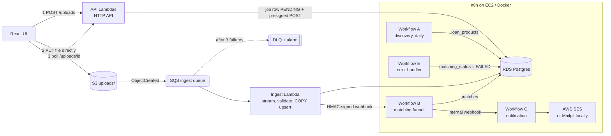

# Loan Eligibility Engine

Upload a users CSV → users are loaded into Postgres → n8n matches users against eligible loan products → matched users are notified via email.

* **Backend:** Python 3.12 Lambda handlers (no web framework), Postgres, S3 → SQS → Lambda ingestion.
* **Automation:** self-hosted n8n with three workflows (A discovery, B matching, C notification) plus an error handler (E).
* **UI:** React (Vite) — upload, progress, matches table.
* **Local:** Docker Compose (Postgres, moto as S3/SQS emulator, Mailpit, n8n) + two Python processes. **AWS:** `backend/serverless.yml` + n8n on an EC2 host.

## Architecture



Why this shape: a presigned S3 upload avoids API Gateway's 10 MB / 29 s limits; S3 → SQS gives buffering, retries and a dead-letter queue; one SQS message = one uploaded file (never one per row).

## Repository layout

```
backend/                Python code, migrations, tests, serverless.yml
  app/handlers/         Lambda entrypoints (api.py, ingest.py, migrate.py)
  app/ingestion.py      CSV → Postgres (streaming, COPY, upsert, idempotency)
  app/validation.py     row validation (pure functions)
  migrations/001_init.sql
  scripts/              local_dev.py (API + SQS worker), bootstrap_local.py, upload_csv.py, resend_webhook.py, benchmark.py
n8n/                    workflows/*.json (generated), code/*.js (Code-node sources), build_workflows.py, init.sh
frontend/               React UI
backend/seed/loan_products.json illustrative products (fictional lenders) so the demo never depends on live sites
docker-compose.yml      local stack            docker-compose.aws.yml   n8n on EC2
users.csv               sample data (10,000 users)
```

## Run locally

Requirements: Docker + Compose, Python 3.12, Node 20+.

```bash
cp .env.example .env                    # defaults work locally; edit optional values (Gemini key etc.)
docker compose up -d                    # postgres, moto, mailpit, n8n (imports + publishes the workflows)

cd backend
python3 -m venv .venv && . .venv/bin/activate
pip install -r requirements-dev.txt
set -a; . ../.env; set +a               # export the variables to this shell
python scripts/bootstrap_local.py       # bucket, queue + DLQ, S3→SQS notification, migrations, seed products
python scripts/local_dev.py             # API on :8000 + SQS worker (leave running)
```

In another terminal, either use the UI …

```bash
cd frontend && npm install && npm run dev      # http://localhost:5173
```

… or the CLI, which follows exactly the same presigned-URL flow:

```bash
cd backend && . .venv/bin/activate && set -a; . ../.env; set +a
python scripts/upload_csv.py ../users.csv
```

Where to look:

| What | Where |
|---|---|
| Emails sent | Mailpit inbox http://localhost:8025 |
| n8n editor (workflows, executions) | http://localhost:5678 (create the owner account on first visit) |
| Job status / matches | `GET http://localhost:8000/uploads/<job_id>` and `/uploads/<job_id>/matches` |
| DB | `docker compose exec postgres psql -U loans -d loans` |

Expected result with `users.csv`: ingest ≈ 1 s, matching ≈ 20 s, 5 emails in Mailpit (capped by `NOTIFY_MAX_EMAILS=5`), upload of the same file again → status `DUPLICATE`.

Try the failure paths: upload a CSV with a bad row (it is rejected individually, the rest loads, and an error report is offered), or stop n8n (`docker compose stop n8n`), upload a file, start n8n again — SQS redelivers and the webhook is sent once n8n is back.

### Tests

```bash
cd backend && . .venv/bin/activate && set -a; . ../.env; set +a
pytest -q          # unit tests + integration tests (needs the compose Postgres; uses a separate loans_test DB, S3 via moto)
```

### Choosing the LLM (free options)

The LLM is used rarely (see "Design decisions": once per distinct wording, cached), so the hosted free tier is usually enough, but no hosted API is free *and* unlimited. Pick one in `.env`:

| `LLM_PROVIDER` | Cost / limits | Setup |
|---|---|---|
| `gemini` (default) | Free tier with rate and daily limits that Google can change | Key from https://aistudio.google.com/apikey → `GEMINI_API_KEY`. Model via `GEMINI_MODEL` (default `gemini-3.5-flash-lite`; older names such as `gemini-2.5-flash` are no longer served to new keys). |
| `ollama` | Free and unlimited: an open model runs on your own machine, no key | `docker compose --profile ollama up -d ollama && docker compose exec ollama ollama pull qwen2.5:3b`, then `LLM_PROVIDER=ollama` (model via `OLLAMA_MODEL`; larger models extract better but need more RAM/CPU). |

After editing `.env`: `docker compose up -d --force-recreate n8n-init n8n`.

### Workflow A (crawler) locally

In the n8n editor open **A - Loan Product Discovery** and press *Execute workflow* (needs a working LLM as above; otherwise it stops with an explicit error and the seeded products stay active). Crawled products are stored under the source `bankbazaar` / `hdfcbank` and join the matching immediately.

## AWS deployment

Full step-by-step guide (SES setup, EC2 for n8n, `serverless deploy`, using the UI against the deployed API, failure drill, teardown, troubleshooting): **[docs/AWS_DEPLOYMENT.md](docs/AWS_DEPLOYMENT.md)**.

One `serverless deploy` creates the stack **including the SES identities and the EC2 host that runs n8n**; then `bash infra/upload_n8n_bundle.sh` hands n8n its workflows.

Variables `backend/serverless.yml` reads at deploy time (template: [backend/deploy.env.example](backend/deploy.env.example)):

| Variable | Required | Meaning |
|---|---|---|
| `VPC_ID`, `SUBNET_A_ID`, `SUBNET_B_ID`, `ROUTE_TABLE_ID` | yes | Existing VPC, two subnets in **different AZs**, and their route table (gets the free S3 gateway endpoint). `bash infra/aws_network_env.sh` prints them for the default VPC. |
| `DB_PASSWORD`, `WEBHOOK_SECRET`, `N8N_ENCRYPTION_KEY` | yes | Secrets (`openssl rand -hex ...`); the webhook secret is shared by the Lambdas and n8n |
| `SES_SENDER_EMAIL`, `TEST_RECIPIENT`, `SES_RECIPIENT_1..3` | yes / 1..3 optional | SES identities the stack creates (sandbox: verify via the emails AWS sends); notifications go to `abcd+1@…`, `abcd+2@…` |
| `GEMINI_API_KEY`, `LLM_PROVIDER`, `GEMINI_MODEL`, `NOTIFY_MAX_EMAILS` | no | LLM for the crawler / free-text criteria; emails per run (default 3) |
| `AWS_REGION`, `CORS_ORIGIN`, `ALERT_EMAIL`, `DB_INSTANCE_CLASS`, `DB_MULTI_AZ`, `DB_ENGINE_VERSION`, `N8N_INSTANCE_TYPE` | no | Defaults: `us-east-1`, `*`, none, `db.t4g.micro`, `false`, `17`, `t3.small` |

## Design decisions

### Ingestion (backend)
* **Direct-to-S3 upload** with a presigned POST that enforces `Content-Type: text/csv` and a size limit.
* **Streaming parse** of the S3 object; valid rows go through Postgres `COPY` into a temp staging table, then one `INSERT … ON CONFLICT (user_id) DO UPDATE`. One transaction per file.
* **Idempotent and safe to retry:** SHA-256 of the file content detects identical re-uploads (`DUPLICATE`, no second matching run); a crash before commit leaves nothing behind; the webhook is retried independently of the load (redelivery of an already-loaded job only re-sends the webhook).
* **Bad rows don't fail the file:** rejected rows are listed in an error CSV in S3 (`COMPLETED_WITH_ERRORS`). A file with a bad header or no valid rows is `FAILED` immediately (retrying can't help).
* **SQS partial-batch failure + DLQ:** the Lambda returns only the failed message ids; after 3 deliveries the job is marked `FAILED` and the message goes to the DLQ (CloudWatch alarm → SNS).
* **Email is not a key.** `users.csv` has 10,000 users but only 2,632 distinct emails, so `user_id` is the primary key and Workflow C sends **one email per distinct address** (products merged, best score kept).
* **Webhook security:** `X-Signature = HMAC-SHA256(secret, timestamp + "." + body)` verified in n8n with a 5-minute replay window.

### The Optimization Treasure Hunt (Workflow B)
The goal: never evaluate a user–product pair with something expensive unless a cheaper stage cannot decide it.

| Stage | Where | What it does |
|---|---|---|
| 0. Scope | n8n + SQL | Only users of *this* upload (`upload_job_id`), only active products with usable criteria; processed in batches of 1,000. |
| 1. SQL pre-filter | Postgres node | One set-based join per batch on income, credit score range, age range, employment (indexed). Drops every pair that cannot match. |
| 2. Score + top-K | Postgres, driven by n8n | Window function scores each surviving pair with weights set in the *Plan Batches* node and keeps only the top 5 products per user, so just those rows leave the database and enter n8n. |
| 3. LLM, once per wording | Code node → Gemini | Products whose eligibility is only free text (`needs_review`) are converted **once** into structured thresholds, cached in `llm_cache` by `md5(text)`. The result then flows through stages 1–2 like any other product. |

The LLM is therefore called per distinct *product wording*, never per user or per user–product pair, and a repeat run costs zero calls. If no key is set or the call fails, those products are skipped (never guessed) and picked up on the next run.

Measured on `users.csv` (10,000 users):

| Catalogue | Pairs | After SQL pre-filter | Matches kept | LLM calls |
|---|---|---|---|---|
| 12 seeded products with structured criteria | 120,000 | 37,371 | 34,302 | 0 |
| + 2 seeded free-text products + 7 crawled products with Gemini (21 products) | 210,000 | 126,685 | 49,086 | 9 first run, 0 after (cached) |

Per-run numbers are stored in `funnel_metrics` and shown in the UI. `python backend/scripts/benchmark.py` prints the report below for the latest run. Latest run (21 products): 210,000 pairs → 126,685 after SQL (39.7% pruned) → **49,086 written (76.6% fewer)**, 9 LLM calls on the first run and **0 on a re-run** (cached) versus 210,000 for one call per pair. The whole stage-1 join over 10,000 users takes about 1 s; a full matching run takes 30–50 s locally.
LLM extractions are sanity-checked (plausible ranges, min ≤ max) before they are cached.

How much the pre-filter prunes depends on the catalogue: the crawled lenders mostly state only a minimum income and age, so they prune less than the seeded products, and the data's ranges are narrow (score 650–800, income 25k–150k). LLM extraction is also imperfect: for the seeded "Community" wording ("Business owners need two years of operation") Gemini restricted the product to Business applicants. Extracted values are cached in `llm_cache` and can be corrected there.

### Crawling (Workflow A)
Daily schedule (plus manual run). Fetches 2 public pages (`bankbazaar.com`, `hdfcbank.com`; edit the list in the *Sources* node) with the HTTP node, strips them to text, skips pages whose SHA-256 is unchanged, and asks Gemini to extract products as JSON (robust to layout changes, which the brief makes optional). Output is validated before an upsert; products that disappear from a page are deactivated only when the new crawl found something; the content hash is stored only after a successful extraction so a failed run is retried. Public pages rarely state per-product income/credit criteria, so such products are stored with their wording and resolved by stage 3. Crawling is polite (one request per source per day, identifying User-Agent); check each site's terms before enabling it in production.

### Notifications (Workflow C)
Reads `matches.notified_at IS NULL`, builds one HTML email per distinct address (CSV values are HTML-escaped), sends through the **AWS SES node** (`EMAIL_TRANSPORT=ses`, 1 email/s for the SES sandbox) or SMTP→Mailpit locally, and marks matches notified only after a successful send, so failures are retried by the next run. **Safety:** it refuses to run unless `TEST_RECIPIENT` is set; every mail goes to `abcd+1@gmail.com`, `abcd+2@gmail.com`, ... (numbered per run, so only a few aliases need verifying in the SES sandbox); real CSV addresses are only used with `NOTIFY_LIVE=true`. `NOTIFY_MAX_EMAILS` caps a run (5 locally, 3 in the AWS example; empty = unlimited).

### Reliability summary
* Postgres/HTTP nodes in n8n retry (3 tries); a failed Workflow B run is marked `FAILED` by Workflow E (via the stored n8n execution id) and can be re-run with `python scripts/resend_webhook.py <job_id>` (a re-run replaces matches that were not emailed yet).
* All writes are idempotent (`ON CONFLICT`, `UNIQUE(upload_job_id, user_id, product_id)`); matches are kept per upload for history.

## Limitations and what was not verified

* **AWS:** the stack (S3, SQS, Lambdas, API, RDS) was deployed and `/health` verified; the EC2 n8n host, SES identities and real SES emails come from the latest template, which passes CloudFormation validation but should be checked as you deploy. The SES node is configured per its parameter schema in n8n 2.42; the local path uses SMTP/Mailpit.
* **Gemini** was exercised end to end (crawler extracted 16 products from the two pages; criteria normalisation made 9 calls). **Ollama** (`qwen2.5:3b`, CPU) also ran the same 9 extractions in about 3 minutes with no key, but the small model was less accurate (it read "at least 60,000" as `min_income: 6000`). Use a larger `OLLAMA_MODEL` or Gemini where accuracy matters, and review `llm_cache` for products you care about.
* LocalStack now requires a licence token, so the local AWS emulator is **moto** (S3, SQS, bucket notifications). Behaviour matches closely but is not identical to AWS.
* No API authentication is configured (open demo API). Add an HTTP API JWT/IAM authorizer before exposing it.
* Scale: designed and tested for ~10k rows per file (single Lambda, one transaction). Millions of rows would need chunking the file across SQS messages — not implemented. RDS is single-AZ and n8n is a single instance (no queue mode); production would use Multi-AZ and RDS Proxy.
* Postgres in the local stack is 17 (n8n 2.x warns about 16). `n8nio/n8n:latest` is used; pin a version for reproducible deployments.
